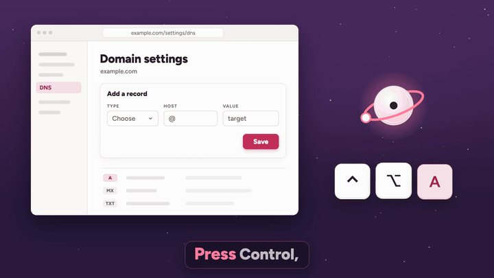
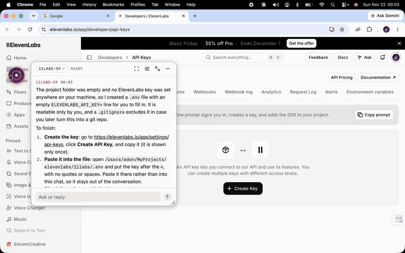

# Sidemoon

Press Control-Option-A in any app: the window you are looking at goes to your Claude Code session, and the answer appears beside your work.

Sidemoon is a small floating companion for macOS.



**A real task**: stuck on a settings page while setting up an API key, one key press, and the answer says what to click.

[](https://www.sidemoon.app/sidemoon-tutorial.mp4)

[Watch the full 53 seconds with narration](https://www.sidemoon.app/sidemoon-tutorial.mp4)

Free and open source (MIT). Requires macOS 14 or later and [Claude Code](https://docs.anthropic.com/en/docs/claude-code/overview). Works with Claude Code only, for now.

Sidemoon is an independent project and is not affiliated with or endorsed by Anthropic. Claude and Claude Code are trademarks of Anthropic.

## What it does

- **One key sends your screen.** Send the active window, drag over a region, or write a note first and then pick a region. The capture goes to the session you chose.
- **The answer appears beside your work.** A small window next to the mascot shows the reply, formatted (lists, code, tables), so you do not switch to the terminal.
- **Talk back right there.** Type questions or replies in the companion window, or drag files onto it.
- **One thread per session.** Each Claude Code session keeps its own conversation, and the conversations are kept across restarts.
- **Start a session from Sidemoon.** The **+** beside "Send to" in the session list (and the main button when there are no sessions yet) opens a short form: pick a folder, from the folders of your recent sessions or with "Choose folder…", and type the first message. Return starts it. Sidemoon starts a Claude Code background session there, makes it the session your captures go to, and its answer shows up in the thread. No terminal, launcher or extra setup is involved. Your home folder is allowed with a one-line caution, except on a Mac where Claude Code has refused to reopen a session there (see below).
- **Hide sessions you do not need.** Point at a session in the list (or move to it with the arrow keys) and choose **Hide**, or press Delete. Nothing is done to the session itself: it only leaves Sidemoon's list. **Undo** shows for a few seconds, **Show hidden** lists them again with **Unhide**, and a hidden session comes back by itself as soon as it answers or needs you. Hidden sessions are not counted on the mascot and are never picked as the session to send to.
- **Knows when you are needed.** A counter on the mascot shows when a session has a new answer or is waiting for you.
- **Messages wait their turn.** If a session is busy, what you send waits until it is free (up to 30 minutes) instead of getting lost.
- **Files named in an answer become buttons.** When a reply mentions a file on your Mac, it shows up as a button that opens it.
- **Short replies, if you want them.** On by default: each message carries a `[via Sidemoon]` tag and, now and then, a note asking the session to answer those messages briefly. Messages typed elsewhere are answered as usual. Turn it off in Settings.
- Themes (Paper, Terminal, Mono), adjustable size, and an option to open at login.

## Install

**Download.** Get the latest version from [sidemoon.app](https://www.sidemoon.app). It is a signed and notarized build for Apple Silicon and Intel Macs; Sidemoon is not distributed through the Mac App Store. Open the downloaded disk image, drag `Sidemoon.app` to your Applications folder and open it from there.

**Homebrew.** Coming. A draft cask is in [`packaging/homebrew`](packaging/homebrew); it is not published yet.

**Build from source.** Needs a Swift 6 toolchain (Xcode 16 or later). The first build downloads the one dependency, Sparkle, through Swift Package Manager.

```sh
git clone https://github.com/EdonZo/sidemoon.git
cd sidemoon
scripts/build-app.sh            # writes dist/Sidemoon.app
```

The script builds the app and the `sidemoon` helper for your Mac's architecture, puts the helper inside the bundle, and signs the bundle ad hoc. macOS ties the Screen Recording permission to the signature, so with ad hoc signing it has to be granted again after every rebuild. To keep it, sign with a certificate from your keychain:

```sh
SIDEMOON_SIGN_IDENTITY="Your certificate name" scripts/build-app.sh
```

## First run

On first launch Sidemoon opens a setup window. Each step says what it changes on your Mac.

1. **Claude Code.** Sidemoon checks that it can find the `claude` command. It looks in `~/.local/bin`, `/opt/homebrew/bin` and `/usr/local/bin`.
2. **Connect to Claude Code.** Adds Sidemoon's hooks to `~/.claude/settings.json`, so Claude Code tells Sidemoon when a session starts, answers or ends. A backup of the file is saved next to it first, and nothing else in it changes. Disconnect removes only Sidemoon's lines, after another backup.
3. **Allow screen capture.** macOS asks you to turn on Sidemoon under Screen Recording in System Settings. macOS applies the change only after the app restarts; the setup window offers a Relaunch button.
4. **Terminal sessions (optional).** Installs the `sidemoon-claude` command in `~/.local/bin` and a small config file in `~/Library/Application Support/Sidemoon`. Start terminal sessions with `sidemoon-claude` instead of `claude` so Sidemoon can send to them. If `~/.local/bin` is not on your PATH, the window tells you the full path to type.

   **Connect every claude you start in a terminal** (off by default) saves you remembering: when it is on, typing plain `claude` goes through `sidemoon-claude`. Sidemoon adds a short, marked block to the startup file of each shell you use (`~/.zshrc` for zsh; `~/.bashrc` and `~/.bash_profile`, or the `~/.bash_login` or `~/.profile` you already have, for bash; `~/.config/fish/functions/claude.fish` for fish), after saving a backup copy of a file it changes for the first time. Terminal windows you open after that pick it up. Commands that do not start a session here (`claude mcp`, `claude -p`, `claude --bg`, `claude --version` and the like) run exactly as before. Claude Code asks you to confirm "I am using this for local development" each time it starts this way; press Return. Turning the switch off removes the block and nothing else. Sidemoon does not write through a link (for example a `~/.zshrc` kept in a dotfiles folder) or into a file it may not change; it says so and offers the lines to copy.

Press **Start** when the steps are done. You can open the setup window again from the companion's right-click menu.

## Shortcuts

They work in any app.

| Keys | What it does |
|---|---|
| Control-Option-A (⌃⌥A) | Send the active window. You get 3 seconds to type a note before it goes. |
| Control-Option-S (⌃⌥S) | Send a region. Drag over the part of the screen you want to show; Escape cancels. |
| Control-Option-N (⌃⌥N) | Send a region with a note. Write the note, press Return, then pick the region. |

If another app already uses one of these keys, the companion's right-click menu says so.

In the note field, Return sends and Escape cancels.

## How it works

Sidemoon has no Dock icon and no menu bar; the floating companion (the mascot and its window) is the whole interface. An engine runs inside the app and listens on a Unix socket in `~/Library/Application Support/Sidemoon` (the folder is readable only by you, and the engine accepts connections only from your own user).

**Knowing about sessions.** Connect writes hooks for the `SessionStart`, `UserPromptSubmit`, `Stop`, `Notification` and `SessionEnd` events into `~/.claude/settings.json`. Each hook runs the `sidemoon` helper inside the app bundle (`Sidemoon.app/Contents/Helpers/sidemoon`), which forwards the event to the engine. Every hook command carries the marker `--sidemoon-managed`, so Disconnect (or `sidemoon hooks uninstall`) removes exactly those entries and nothing else. If the app is deleted, the hooks check that the helper exists and do nothing. Sidemoon also reads `claude agents` to list background sessions, and reads replies from the session transcripts under `~/.claude/projects`.

**Delivering a message.** How a message reaches a session depends on how the session was started:

- **Terminal sessions started with `sidemoon-claude`.** The launcher runs `claude --mcp-config=<config> --dangerously-load-development-channels=server:sidemoon`, which loads Sidemoon as a channel: an MCP server that can push messages into the running session. Channels are a research preview in Claude Code and may change. When Claude Code moves such a session to the background, the process that then hosts it loads Sidemoon without the channel flag, and Claude Code ignores what it pushes. The helper checks its parent's command line and tells the engine, so such a session is not shown as connected; if a message is still not taken in within 20 seconds, the send fails and Retry uses the background route.
- **Background sessions (`claude --bg`).** Sidemoon stops the session and resumes it with the message using `claude --resume <id> --bg "<message>"`, then checks that the same session continued rather than a copy. Stopping a session ends any background shells or agents it had running; when that happens, the message tells the session so.
- **Ended sessions.** Sidemoon resumes them headlessly with `claude -p --resume <id>` and shows the answer.

A terminal session started with plain `claude` cannot be reached, unless **Connect every claude** is on. Chats in the Claude desktop app are not supported.

**Starting a session.** The new-session form runs `claude --bg -- "<message>"` in the chosen folder (the `--` keeps a message that starts with a dash from being read as an option). With **Short replies** on, the first message carries the same note as any other message. Claude Code prints `backgrounded · <id> · <name>` within about a second; Sidemoon waits until `claude agents` lists that session, and from then on it is an ordinary background session: the first answer arrives through the `Stop` hook, and later messages take the background route above. Sidemoon does not name the session; while it has no name, the list shows its folder. If Claude Code refuses (a folder it does not trust, a login that has expired) or the command fails, the form says so in plain words and keeps what you typed; what Claude Code printed is under **Details**. Starting cannot be cancelled once it has begun: by then the session exists. Sidemoon remembers the last folder you started in.

**Hidden sessions.** Hiding only changes Sidemoon's list; no command is run against the session. The hidden list is kept in Sidemoon's settings (up to 200 sessions); one Sidemoon has not seen for 30 days is forgotten. A hidden session comes back when it produces a new answer or starts waiting for you (a permission prompt), never merely because the list was refreshed.

**Open in Terminal.** Under the pointer, a background session's row offers to open it in the Terminal app. That runs `claude attach <id>`, Claude Code's own way to show a background session in a terminal; the session keeps running in the background either way.

**The launcher decides.** `sidemoon-claude` adds the channel only when it starts an interactive session in this terminal. A subcommand (`agents`, `attach`, `auth`, `auto-mode`, `doctor`, `gateway`, `import`, `install`, `logs`, `mcp`, `plugin`, `purge`, `respawn`, `rm`, `setup-token`, `stop`, `ultrareview`, `update` and their other names), or any of `-p`/`--print`, `--bg`, `--version`, `--help`, `--desktop`, `--cloud` or `--environment` before a `--`, runs plain `claude` with the same arguments. So does every launch while the Sidemoon helper or its config file is missing, so a deleted app never breaks `claude`. The block **Connect every claude** writes only calls the launcher (and plain `claude` when the launcher is gone). Setup rewrites a launcher an earlier version of Sidemoon installed.

When Claude Code starts with the channel it also prints `server:sidemoon · no MCP server configured with that name`. This is harmless: that check looks only at the MCP servers configured in Claude Code's own files (a server in a project's `.mcp.json` does not get the warning), not at those passed with `--mcp-config`, and the channel still loads and delivers. Registering Sidemoon in Claude Code's settings would silence it, but would also start the helper in every session, so Sidemoon does not.

A session whose folder was moved or deleted cannot be reopened; Sidemoon greys it out with that reason and never picks it on its own. "Open in Terminal" checks the folder and the launcher before it opens anything.

**Sessions Sidemoon cannot send to.** Claude Code refuses to resume some background sessions, and Sidemoon checks for these before it stops anything:

- A running background session that was started in your home folder, once Claude Code on your Mac has refused to reopen one ("the home directory is trusted one session at a time"). Some Macs never refuse; Sidemoon remembers a refusal and forgets it when Claude Code reopens a home-folder session again.
- A running session that is stuck before its first answer, or one whose login has expired.

Sidemoon shows these greyed out, with the reason. To use one anyway, reopen it in a terminal with the launcher, which connects it through the channel instead:

```sh
~/.local/bin/sidemoon-claude --resume
```

**Images and files.** For live sessions, the capture and any dropped files are copied into that session's scratchpad folder (under `/tmp/claude-<uid>/`) so Claude Code can read them without a permission prompt. Files up to 50 MB can be sent; folders cannot.

## Privacy

- **No server, no account.** Sidemoon talks only to Claude Code on your Mac, through the `claude` command, the hooks and the channel. What a session then sends to Anthropic is up to Claude Code, as with any message you type into it.
- **The only network request is the update check.** Sidemoon uses [Sparkle](https://sparkle-project.org) to look for new versions: it reads `https://www.sidemoon.app/appcast.xml`, and updates are verified with a signing key before they are installed. "Check automatically" in Settings turns the check off. Apart from this, Sidemoon makes no network requests of its own.
- **No telemetry.** There is no analytics or tracking code in the app.
- **Captures are deleted after sending.** Sidemoon keeps captures in `~/Library/Application Support/Sidemoon/Captures` only until they are sent, and deletes them whether the send succeeds or not. The copy placed in the session's scratchpad folder (see above) is left for Claude Code to read.
- **Conversations stay on your Mac.** They are saved in `~/Library/Application Support/Sidemoon/threads.json` (up to 200 entries per session, for the 40 most recently used sessions). "Clear conversations" in Settings removes them; the sessions themselves are not touched.
- **The companion stays out of screenshots.** The companion window is excluded from screen sharing and screen captures, including Sidemoon's own.

## Uninstall

1. Open Setup from the companion's right-click menu and press **Disconnect**. This removes Sidemoon's hooks from `~/.claude/settings.json` after saving a backup next to it (`settings.json.sidemoon-backup-<timestamp>`), and turns off **Connect every claude**, which takes Sidemoon's block out of your shell startup files. From a terminal, the hooks part:

   ```sh
   /Applications/Sidemoon.app/Contents/Helpers/sidemoon hooks uninstall
   ```

   If Sidemoon is already gone, delete the lines from `# >>> sidemoon >>>` to `# <<< sidemoon <<<` in `~/.zshrc`, `~/.bashrc`, `~/.bash_profile`, `~/.bash_login` or `~/.profile`, and the file `~/.config/fish/functions/claude.fish` if it holds only that block. Until you do, `claude` still works: with the launcher gone it runs plain `claude`.

2. Turn off **Open at login** in Settings if you turned it on, then quit Sidemoon.
3. Delete `Sidemoon.app`, and move these to the Trash if they exist: `~/.local/bin/sidemoon-claude` and `~/Library/Application Support/Sidemoon`.
4. Forget saved settings and the Screen Recording permission:

   ```sh
   defaults delete app.sidemoon.companion
   tccutil reset ScreenCapture app.sidemoon.companion
   ```

**Reset for testing.** `scripts/reset-first-run.sh [path-to-app]` does steps 1 (including the shell startup files, after a backup), 3 (except deleting the app) and 4, then opens the app again as a new user would see it. The default path is `~/Applications/Sidemoon.app`. It also clears what builds from before the rename (Tagalong) left behind.

## Building and testing

```sh
swift build                 # debug build of the library, the app binary and the CLI
swift test                  # unit tests (the end-to-end scenarios are skipped)
scripts/e2e.sh              # end-to-end scenarios against real Claude Code sessions
scripts/build-app.sh        # Sidemoon.app in dist/
```

The code is split into:

- `Sources/SidemoonCore` — the engine: hooks installer, session registry, delivery routes, channel server, transcript reader.
- `Sources/sidemoon` — the `sidemoon` command-line helper (`sidemoon hooks install|uninstall|status`, `sidemoon sessions`, `sidemoon send`, and the `hook` and `channel` subcommands that Claude Code runs).
- `Sources/SidemoonCompanion` — view models and UI logic without AppKit, so they can be tested headless. Every tunable value is in `CompanionConstants.swift`, and every user-facing string is in `DesignTokens.swift` (`Design.Copy`).
- `Sources/SidemoonApp` — the AppKit and SwiftUI app.

Tests do not touch your real `~/.claude/settings.json` or the Screen Recording permission.

### End-to-end tests

`scripts/e2e.sh` runs every scenario against real, throwaway Claude Code sessions: an idle and a busy background session, one in your home folder, one stopped before it answered, an ended one, a terminal session started with the channel, a screenshot and a dropped file, Retry after a failed send, whether the session list tells the truth, and a session started from the companion that answers its first and second message. `scripts/e2e.sh --list` lists them and `scripts/e2e.sh <name>` runs one. It prints PASS or FAIL for each, with what was seen when one fails.

It uses a little Claude usage (the `haiku` model and one-line prompts). It runs beside your own Sidemoon: its engine has its own socket in a scratch folder (`SIDEMOON_SUPPORT_DIR`, used only by these tests), its sessions are named `sidemoon-e2e-…` and only ever get messages from it, and it never sends to, stops or resumes a session it did not start. When it ends, even on failure or Control-C, it stops and removes every session it started (including the one in your home folder), and deletes its scratch folders and the data Claude Code kept for them. The interactive scenarios answer Claude Code's "local development" channel question and its folder trust question themselves.

## Contributing

Issues and pull requests are welcome. For anything larger than a small fix, open an issue first so we can agree on the approach. Please keep changes focused, add tests for logic in `SidemoonCore` and `SidemoonCompanion`, put new constants and strings with the existing ones, and run `swift test` before sending. See [PLAN.md](PLAN.md) for what is planned next.

## Licence

MIT. See [LICENSE](LICENSE). Copyright (c) 2026 Dardan Labs.
